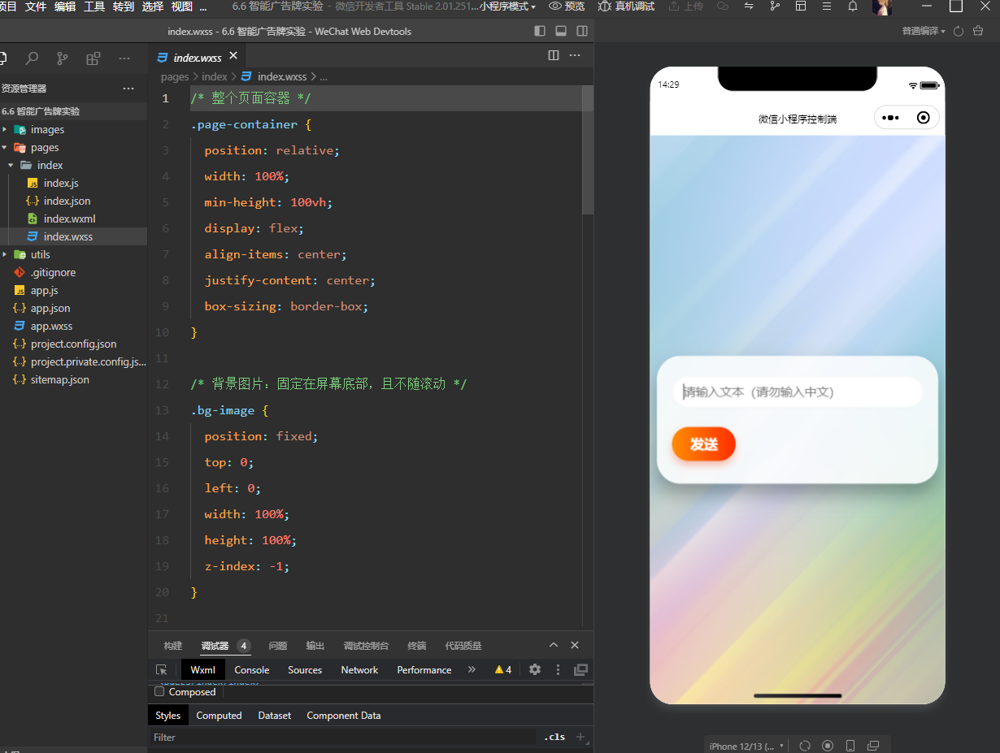
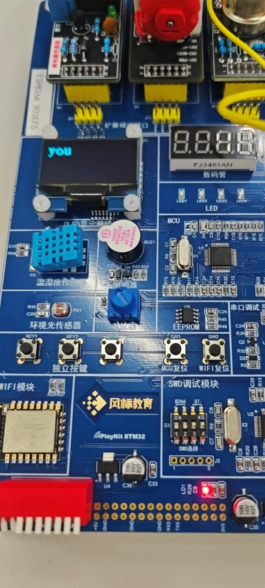
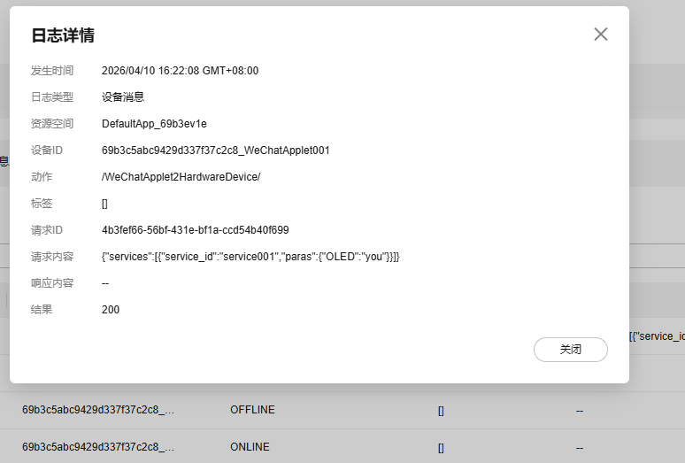
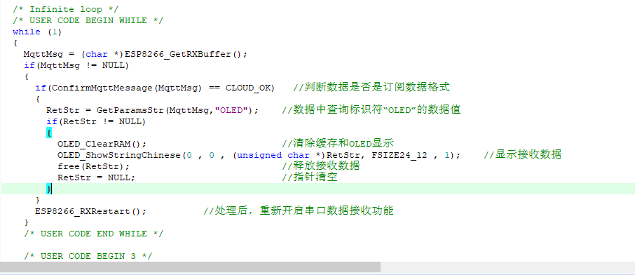

# stm32-esp8266-huaweicloud-iot · STM32 + ESP8266 上华为云 + 微信小程序远程控制

本科课程《嵌入式系统开发》实验五作品：**微信小程序下发指令 → 华为云 IoT 转发 → ESP8266 接收 → STM32 解析 → OLED 屏显示**，并回传传感器数据上云。
一套完整的"端-云-端"物联网链路，全部在真实硬件上跑通。

> 说明：本仓库以**课程实验报告中的真实截图 + 实现讲解**为主。
> 原始工程代码留在学校实训电脑上，找回后会补充 `code/` 目录（见下方「源码说明」）。

## 架构与数据流

```
┌────────────┐   下发指令    ┌──────────────┐   MQTT   ┌─────────┐  UART  ┌────────┐
│ 微信小程序 │ ───────────► │  华为云 IoT   │ ───────► │ ESP8266 │ ─────► │ STM32  │
│  控制端     │              │  设备接入     │          │ WiFi模组 │  AT指令 │  主控   │
└────────────┘              └──────────────┘          └─────────┘        └───┬────┘
      ▲                                                                      │
      │              上传温湿度/光照等传感器数据                              ▼ OLED 屏显示
      └──────────────────────────────────────────────────────────────────────┘
```

一条下行链路（云 → 设备）和一条上行链路（设备 → 云）构成闭环：

1. **下行**：小程序点击"下发" → 华为云记录设备消息（日志可见，返回 200）→ ESP8266 收到云端推送 → STM32 串口读取缓冲区 → 解析出要显示的内容 → `OLED_ShowString()` 刷屏
2. **上行**：STM32 采集温湿度/光照传感器 → 组包 → ESP8266 上报 → 华为云设备影子/消息记录 → 小程序侧可查

## 实验证据（均为本人实验报告截图）

| 环节 | 证据 |
| --- | --- |
| ① 控制端 | 微信开发者工具中的小程序控制页面  |
| ② 设备端实物 | PlayKit STM32 开发板 + ESP8266 WiFi 模块 + 温湿度/光敏传感器，OLED 屏显示小程序下发的内容  |
| ③ 云端链路 | 华为云 IoT 设备消息日志：WeChatApplet 下发 OLED 显示命令，状态 200 成功  |
| ④ 设备端解析 | STM32 端代码：读取 ESP8266 接收缓冲区 → 解析 MQTT 消息 → 格式化后送 OLED 显示  |

## 技术要点

- **ESP8266 与 STM32 的分工**：ESP8266 只负责网络（连 WiFi、接云、收推），STM32 负责业务（传感器采集、解析、显示）。两者 UART 通信，职责清晰、便于单独调试。
- **串口数据解析**：从 ESP8266 接收缓冲区拿到的是带 MQTT 主题前缀的原始字符串，STM32 端需要定位有效字段、截取内容再送显——这是设备端最容易出错的一环（边界、粘包、缓冲长度）。
- **云端调试的价值**：华为云的"设备消息日志"能看到每次下发的报文和状态码。链路不通时先上云看日志，能直接把问题定位到"云没收到"还是"设备没解析对"。
- **上行+下行闭环**：只做单向（设备→云）是最常见的 Demo 形态；加上云→设备的下行控制，才构成可交互的完整系统。

## 源码说明（诚实标注）

- [ ] 找回实训电脑上的原始工程并补充 `code/`
- [ ] 补充：ESP8266 连云的 AT 指令序列 / MQTT 主题设计
- [ ] 补充：传感器数据上报的报文格式

本仓库当前内容全部基于实验报告截图与本人实现过程，未使用任何未经验证的示例代码充数。

## 面试可以怎么讲（简版）

> 课程实验里做过一个完整的物联网链路：STM32 通过 ESP8266 上华为云，微信小程序作为控制端下发指令，
> 设备端解析后把内容显示在 OLED 上，同时把温湿度/光照数据上传云端。
> 调试时主要靠云平台的设备消息日志定位问题——能分清是云端没收到，还是设备端解析出错。

完整版问答见 [docs/面试问答.md](docs/面试问答.md)。

## License

MIT
